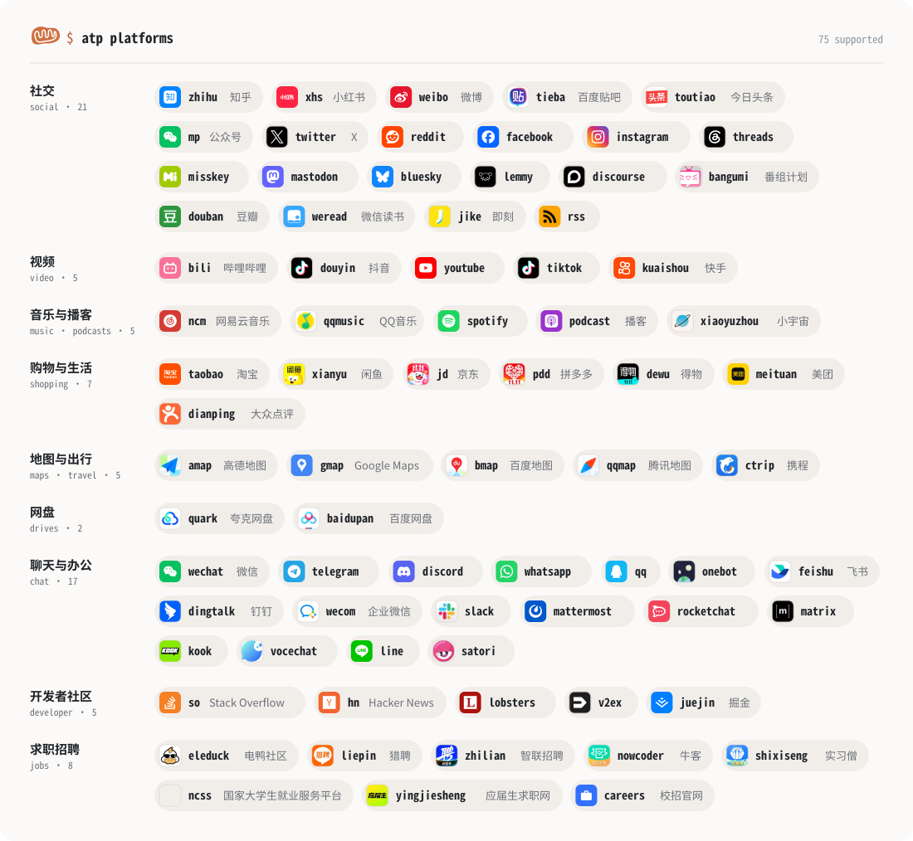

<p align="center">
  <picture>
    <source media="(prefers-color-scheme: dark)" srcset="docs/assets/atp-logo-dark.svg">
    
  </picture>
</p>

<p align="center">
  <strong>One command for all the platforms.</strong>
</p>

<p align="center">
  <a href="docs/output.md">输出格式</a> ·
  <a href="docs/architecture.md">架构</a> ·
  <a href="README.md">English</a>
</p>

---

ATP（all-the-platforms）用同一套命令在知乎、小红书、微博、哔哩哔哩、抖音、微信、Telegram、
Discord、YouTube、TikTok、Reddit、Twitter / X 等平台上浏览、搜索、发布、聊天和下载。
在终端里给人看，在脚本和 AI Agent 里则输出稳定的 JSON / YAML；支持 Linux、macOS 和 Windows。

<picture>
  <source media="(prefers-color-scheme: dark)" srcset="docs/assets/platforms-dark.svg">
  
</picture>

```console
$ atp bili search "rust 教程" -n 3
 #  Content                                                      Author        Likes  Cmts  Views   Time
 1  Rust编程语言入门教程（Rust语言/Rust权威指南配套）【已完结】  软件工艺师    26.1k  2.6k    1.7M  2020-10-21
 2  【Rust腐蚀 新手教程】2026保姆级教程 实时更新！！！           Utaoki丶苦药   1.9k   401  155.3k  2025-01-13
 3  Rust语言 Slint教程，非tauri                                  猩猩程序员        0     0    7.5k

$ atp bili read '#1'
$ atp tg listen -f jsonl          # 实时输出每一条新的 Telegram 消息
```

## 为什么用 ATP

- **学一次，到处用。** `search`、`hot`、`feed`、`read`、`comments`、`user`、
  `like`、`comment`、`follow`、`post`、`download` 等命令在每个平台含义相同，
  聊天类平台共用 `chats`、`messages`、`send`、`react` 和 `listen`。
  `atp platforms` 列出各平台支持的功能。
- **为 Agent 和脚本设计。** 所有结果都装在同一个信封里，字段和错误码稳定；
  输出被管道接走时自动切换为 YAML。帖子、消息、用户、评论在各平台是同一种结构。
  `atp mcp` 把所有平台作为 MCP 服务提供给 AI Agent。
- **也是 Rust 库。** 想基于某个平台做自己的项目，把它作为 crate feature 引入，
  用带类型的方法调用同样的功能。
- **直接用于数据分析。** 创作者后台数据（`insights`：趋势、流量来源、观众画像）、
  点赞和转发的人、完整的评论楼中楼、聊天记录导出、`--since` / `--until` 时间过滤，
  以及可直接导入 pandas / DuckDB 的 CSV、JSON Lines 输出。
- **实时事件。** `listen` 实时输出聊天、群组和频道里的新消息，每条一行或一个 JSON 对象。
- **短引用。** 任何列表之后，`#3` 就是「第三条」，不用复制长长的 id 或链接。
- **翻页不丢位置。** `-n 200` 自动翻页；`--cursor` 从上次停下的地方精确继续。
- **登录省事。** 用 App 扫码，沿用浏览器里的登录状态，或填入机器人 Token、API 密钥。
  登录状态只保存在本机。
- **很多功能无需账号。** 大多数平台的公开视频、帖子、评论、用户、频道和文章都能直接看。
- **自带下载。** 原图、合并好音轨的视频、纯音频，或可直接用于语音识别的 WAV 分段。
- **像浏览器一样访问。** 浏览器的网络指纹、各平台的请求签名和克制的请求节奏，
  让请求看起来和普通浏览无异。
- **人机验证交给你自己。** 遇到验证码或风控时，会在你的浏览器里带着登录状态打开验证页；
  通过后命令自动继续。

## 支持的平台

| | 平台 | 命令 | 主要能力 | 登录方式 |
| --- | --- | --- | --- | --- |
| 社交 | 知乎 | `zhihu` | 回答、文章、想法、提问、创作者数据 | 扫码、浏览器 |
| | 小红书 | `xhs` | 笔记、评论、私信、直播弹幕、活动中心、创作者数据 | 扫码、浏览器 |
| | 微博 | `weibo` | 微博、热搜、评论、转发、数据 | 扫码、浏览器 |
| | 百度贴吧 | `tieba` | 吧、帖子、楼层、签到 | 扫码、浏览器 |
| | 今日头条 | `toutiao` | 文章、视频、微头条、评论、热榜 | 扫码、浏览器 |
| | 微信公众号 | `mp` | 文章、合集、草稿、发表、留言、数据 | 扫码、AppID |
| | Twitter / X | `twitter` | 推文、对话、列表、数据 | 浏览器 |
| | Reddit | `reddit` | 帖子、评论、社区、收件箱 | 浏览器、应用 |
| | Facebook | `facebook` | 个人页、公共主页、小组、主页数据、广告 | 浏览器、Token |
| | Instagram | `instagram` | 帖子、Reels、快拍、私信、数据、广告 | 浏览器、Token |
| | Threads | `threads` | 帖子与轮播、对话、提及、搜索、数据，使用你自己的 Meta 应用 | Token |
| | Misskey | `misskey` | 帖子、时间线、表情回应、聊天 | MiAuth、Token |
| | Mastodon | `mastodon` | 嘟文、时间线、趋势、转嘟、书签，任意实例 | OAuth、Token |
| | Bluesky | `bluesky` | 帖子、对话、Discover 与自定义 Feed、趋势、书签 | 应用密码 |
| | Lemmy | `lemmy` | 社区、帖子、完整评论树、投票、回复，任意实例 | 密码、Token |
| | Discourse | `discourse` | 话题、帖子、分类、搜索、点赞、书签，任意论坛（如 linux.do） | User API Key、API Key |
| | Bangumi 番组计划 | `bangumi` | 动画、书籍、音乐与游戏条目、每日放送、角色与制作人员、我的收藏与进度 | Token |
| | 豆瓣 | `douban` | 电影、图书与音乐的评分、短评与影评书评，Top 250 等榜单，小组，用户的想看与看过 | 扫码、浏览器 |
| | 微信读书 | `weread` | 书城搜索与榜单、我的书架与阅读进度、划线与想法（可导出 Markdown） | 扫码、浏览器 |
| | 即刻 | `jike` | 动态与转发、评论、关注与推荐动态流、圈子、通知、带图发动态 | 扫码、Token |
| | 虎扑 | `hupu` | 首页与各分区的热帖、版块、帖子与回复及亮了；登录后回帖、点亮回复、查看提到我的 | 无需登录、浏览器 |
| | 知识星球 | `zsxq` | 已加入的星球、主题、精华与问答、评论、文件、搜索、所有星球的动态；点赞、评论、发主题 | 浏览器 |
| | RSS | `rss` | RSS、Atom 与 JSON Feed、订阅列表与合并时间线、RSSHub 路由、Miniflux | 无需登录、Miniflux Key |
| 视频 | 哔哩哔哩 | `bili` | 视频、弹幕、字幕、投币、创作者数据 | 扫码、浏览器 |
| | 抖音 | `douyin` | 视频、图文、热榜、直播弹幕、无水印下载 | 扫码、手机号、浏览器 |
| | YouTube | `youtube` | 视频、Shorts、字幕文本、播放列表、数据 | 浏览器 |
| | TikTok | `tiktok` | 视频、音乐、话题、直播弹幕、广告 | 扫码、浏览器 |
| | 快手 | `kuaishou` | 视频、图集、评论、热榜、直播间 | 扫码、浏览器 |
| 音乐 / 播客 | 网易云音乐 | `ncm` | 歌曲、歌词与翻译、歌单、榜单、评论、音乐云盘 | 扫码、浏览器 |
| | QQ 音乐 | `qqmusic` | 歌曲、歌词与翻译、歌单、榜单、评论 | 扫码、浏览器 |
| | Spotify | `spotify` | 搜索、音乐库与歌单、最常听的歌曲和艺人、播放控制 | 应用 |
| | 播客 | `podcast` | Apple 播客目录与榜单、来自节目 RSS 的单集与节目介绍、断点续传下载、Podcast Index | 无需登录、Key |
| | 小宇宙 | `xiaoyuzhou` | 节目、单集与节目介绍、热门评论、主播、下载；只读 | 无需登录 |
| 购物 | 淘宝 / 天猫 | `taobao` | 商品、评价、店铺、和卖家聊天 | 扫码、浏览器 |
| | 闲鱼 | `xianyu` | 二手商品、卖家、收藏、聊天 | 扫码、浏览器 |
| | 京东 | `jd` | 商品与价格、评价、店铺、热词 | 浏览器 |
| | 拼多多 | `pdd` | 商品、评价、店铺、首页推荐 | 浏览器、多多进宝 |
| | 得物 | `dewu` | 社区动态、无水印视频、开放平台价格与销量 | Key |
| | 美团 | `meituan` | 联盟团购与榜单、店铺评价、城市定位 | Key、浏览器 |
| | 大众点评 | `dianping` | 店铺、评分、评价、发现笔记 | 扫码、浏览器 |
| | Steam | `steam` | 商店搜索、游戏详情与任意地区价格、热销与特惠、按语言和好评差评筛选的用户评测；用 Web API Key 查看公开资料与已拥有的游戏 | 无需登录、Key |
| | 什么值得买 | `smzdm` | 好价（价格、商城、值与不值）、文章、评论、首页精选；搜索需要 Chrome、Chromium、Edge 或 Brave；只读 | 无需登录 |
| 地图 / 出行 | 高德地图 | `amap` | 地点、地理编码、路线、天气、路况 | Key |
| | Google 地图 | `gmap` | 地点、照片、地理编码、路线、距离矩阵、时区、海拔 | Key |
| | 百度地图 | `bmap` | 地点、地理编码、路线、天气、路况 | Key |
| | 腾讯地图 | `qqmap` | 地点、地理编码、路线、行政区划、天气 | Key |
| | 携程 | `ctrip` | 景点、酒店、分项评分点评、榜单、火车票与中转、机票低价日历、游记笔记 | 浏览器 |
| 网盘 | 夸克网盘 | `quark` | 文件与文件夹、断点续传下载、秒传上传、分享、转存 | 扫码、浏览器 |
| | 百度网盘 | `baidupan` | 文件与文件夹、分享、转存、离线下载；通过自己的开放平台应用断点续传下载、秒传上传 | 扫码、浏览器、应用 Key |
| 聊天 | 微信（ClawBot） | `wechat` | 接收并回复消息 | 扫码 |
| | Telegram | `telegram` | 对话、频道、群组、机器人、频道数据 | 扫码、手机号、机器人 |
| | Discord | `discord` | 服务器、频道、私信、搜索 | 扫码、Token |
| | WhatsApp | `whatsapp` | 对话、群组、Cloud API | 扫码、Token |
| | QQ | `qq`、`onebot` | 官方机器人；通过 OneBot 连接 NapCat / Lagrange | Token |
| | 飞书 / Lark | `feishu` | 群聊、消息、事件 | 应用 |
| | 钉钉 | `dingtalk` | 机器人消息、事件 | 应用、Webhook |
| | 企业微信 | `wecom` | 应用消息、微信客服、智能机器人事件 | 应用、Webhook |
| | Slack | `slack` | 频道、讨论串、搜索、Socket Mode | Token |
| | Mattermost | `mattermost` | 团队、频道、讨论串、搜索 | Token |
| | Rocket.Chat | `rocketchat` | 房间、讨论串、搜索 | Token |
| | Matrix | `matrix` | 房间、空间、公开目录 | Token、密码 |
| | KOOK | `kook` | 服务器、频道、私信 | Token |
| | VoceChat | `vocechat` | 频道、私聊 | 密码、密钥 |
| | LINE | `line` | 推送、群发、受众数据 | Token |
| | Satori | `satori` | 任意 Satori 服务端 | Token |
| 开发者社区 | Stack Overflow / Stack Exchange | `so` | 问题及其回答与评论、标签、用户，覆盖所有 Stack Exchange 站点 | 应用 Key、Token |
| | Hacker News | `hn` | 首页各榜单、帖子、完整评论树、搜索 | 无需登录 |
| | Lobsters | `lobsters` | 最热、最新与活跃帖子、评论树、标签、搜索 | 无需登录 |
| | V2EX | `v2ex` | 最热与最新主题、回复、会员、节点、通知 | Token |
| | 掘金 | `juejin` | 文章（转为纯文本）、沸点、热榜、评论与回复、用户、点赞、收藏集、每日签到 | 浏览器 |
| | DEV / Forem | `forem` | 文章（含 Markdown 原文）、热门、各时段最热与最新列表、标签、评论树、用户；用 API Key 发布文章、保存草稿、修改文章；dev.to 或任意 Forem 社区 | 无需登录、API Key |
| 求职招聘 | 电鸭社区 | `eleduck` | 远程与兼职工作（按标签筛选、从标题读出薪资）、讨论、评论、我的投递 | 扫码、浏览器、Token |
| | 猎聘 | `liepin` | 职位搜索（按城市、薪资、经验、行业筛选）、职位与公司详情、收藏、逐个投递、与招聘方的聊天 | 扫码、浏览器 |
| | 智联招聘 | `zhilian` | 职位搜索（按城市、薪资、经验、学历、职位类型筛选，结果含完整职位描述）、职位与公司详情、逐个投递 | 浏览器 |
| | 牛客 | `nowcoder` | 校招、实习与社招职位（按城市、职位类别、届别、薪资筛选）、校招日程（含内推码与网申链接）、面经、帖子、评论、收藏职位、投递记录 | 扫码、浏览器、Token |
| | 实习僧 | `shixiseng` | 实习职位（按城市、每周天数、实习月数、学历、日薪、转正机会筛选）、校招职位、职位与公司详情、收藏职位、投递记录、逐个投递 | 扫码、浏览器 |
| | 国家大学生就业服务平台 | `ncss` | 面向高校毕业生的职位（按地区、类型、薪资、学历、职位类别、行业、来源筛选）、职位与单位详情、专场招聘会及其职位与单位、收藏职位、逐个投递 | 浏览器 |
| | 应届生求职网 | `yingjiesheng` | 宣讲会（按省份、城市、学校、公司、日期、行业筛选，含地点、时间与宣讲内容） | 无需登录 |
| | 校招官网 | `careers` | 企业自己的招聘官网：字节跳动、腾讯、阿里巴巴、美团、快手直接用简称，飞书招聘、北森、Moka 搭建的官网用链接（牛客校招日程里的网申链接即可）；按招聘类型、城市、批次、职位类别筛选职位，职位详情含投递链接 | 无需登录 |
| | 领英 LinkedIn | `linkedin` | 按地点、发布时间、公司搜索职位，职位详情（职级、雇佣类型、标出的薪资、投递方式）、公司主页及其在招职位；只读，不涉及个人信息 | 无需登录 |
| | 一亩三分地 | `1point3acres` | 面经、内推与海外生活：热门与最新帖子、版块（可按分类筛选）、帖子及其回复、招聘帖的公司、地点与薪资；登录后可搜索、查看用户资料、回帖 | 浏览器 |
| | 前程无忧 | `51job` | 职位搜索（按城市、薪资、经验、学历、公司性质与规模、职位类型筛选，结果含完整职位描述）、职位与公司详情；需要 Chrome、Chromium、Edge 或 Brave | 无需登录 |
| | BOSS直聘 | `boss` | 城市页的热招职位；登录后（尚未用真实账号验证）：收藏职位、关注公司、投递与面试记录、与招聘方的聊天、逐个打招呼投递；职位搜索与职位、公司详情（经 Chrome、Chromium、Edge 或 Brave 读取）目前被网站的安全检查拦截 | 扫码、浏览器 |
| | 程序员客栈 | `proginn` | 面向程序员的远程与驻场兼职职位（按城市、职业角色筛选）、职位详情（含完整描述）；登录后（尚未用真实账号验证）：未读消息数、逐个申请接单 | 浏览器 |

## 快速开始

```sh
yay -S all-the-platforms-bin           # Arch Linux（AUR），也可选 all-the-platforms / -git
brew install windusth/tap/atp          # macOS（Apple 芯片）和 Linux
```

也可以从 [Releases](https://github.com/WindustH/atp/releases) 下载 Linux、macOS 或
Windows 版本，或从源码构建（需要 Rust 1.88+，以及构建 TLS 库所需的 `cmake` 和 `clang`，
Windows 上还需要 NASM；`ffmpeg` 可选，用于合并视频和音频）：

```sh
cargo install --path .
```

不登录先试试：

```sh
atp bili search "rust 教程" -n 5
atp bili comments '#1'
atp x user-posts NASA -n 10
atp xhs read https://www.xiaohongshu.com/explore/68cfff45000000001003c253
atp reddit sub rust --sort top --time week -n 5
atp youtube search "rust tutorial" --filter video -n 5
atp yt transcript https://youtu.be/5C_HPTJg5ek
atp mp read https://mp.weixin.qq.com/s/nwv1BVYGbpuYJO0bPp-APQ
atp tg messages @telegram -n 20
atp misskey feed --type global -n 10
atp bsky hot -n 10
atp hn hot -n 10
atp podcast search 'hardcore history'
atp rss read https://blog.rust-lang.org/feed.xml
atp so search "[rust] borrow checker" -n 5
```

登录后解锁全部功能：

```sh
atp bili login                 # 用 B 站 App 扫码
atp tg login                   # 在 Telegram「设备 → 连接桌面设备」中扫码
atp twitter login --cookie 'auth_token=...; ct0=...'
atp reddit login --browser     # 沿用浏览器里的登录状态
atp slack login --token xoxb-...
atp zhihu status
```

更多例子：

```sh
atp zhihu hot -n 10
atp xhs search 咖啡 --sort popular
atp x read https://x.com/NASA/status/2104695667180380260 --json
atp bili subtitle BV1xx411c7mD
atp bili download BV1xx411c7mD --audio-only --split 25
atp twitter post "Hello" -i photo.jpg
atp reddit comments '#1' --sort top
atp reddit post "Hello from the terminal" --title "Hi" --topic r/test
atp reddit follow r/rust
atp youtube user @Fireship
atp yt comments '#1' --sort new --all --replies -f csv > comments.csv
atp youtube download https://www.youtube.com/shorts/fwBIZRq-vzY
atp tg chats                                   # 你的对话列表，然后：
atp tg messages '#3' -n 500 --since 7d -f jsonl > group.jsonl
atp discord send '#2' 'Hello' -a chart.png
atp feishu listen -f jsonl                     # 实时输出事件
```

每个平台还有更短的名字（`bilibili`、`x`、`xiaohongshu`、`zh`、`rd`、`yt` 等）。把程序链接成
`bili`、`xhs`、`twitter`、`zhihu`、`reddit` 或 `youtube`，就能省掉平台名：
`ln -s $(which atp) ~/.local/bin/bili`。

在 AI Agent 里通过 MCP 使用：

```sh
claude mcp add atp -- atp mcp              # 或 atp mcp --read-only（只读）
```

在 Rust 项目里当作库使用：每个平台是一个 feature，每条命令都是带类型的方法，登录状态和签名与命令行共用。

```toml
[dependencies]
atp = { git = "https://github.com/WindustH/atp", default-features = false, features = ["zhihu"] }
```

```rust
use atp::{PageReq, Platform, zhihu::Zhihu};

let zhihu: Zhihu = atp::open()?;                 // 使用 `atp zhihu login` 保存的登录状态
let hot = zhihu.hot(None, &PageReq::first(10)).await?;
```

## 文档

完整的使用文档内置在程序里：

```sh
atp guide                 # 主题列表：start、login、refs、output、analysis、download ...
atp guide analysis        # 创作者数据、导出、定时快照
atp guide bili            # 单个平台：命令、引用格式、登录、限制
atp bili search --help    # 单个命令的选项和示例
```

（内置文档为英文。）

## 须知

- `ATP_<平台>_COOKIE`（例如 `ATP_BILI_COOKIE`）可以临时提供 Cookie 而不保存。
  `--proxy` 或 `HTTPS_PROXY` 让请求走代理。
- `--interval 5`（或 `ATP_INTERVAL=5`）让请求之间至少间隔 5 秒，适合大批量采集。
- 登录状态保存在 `~/.config/all-the-platforms/<平台>/session.json`（仅本人可读；
  macOS 为 `~/Library/Application Support`，Windows 为 `%APPDATA%`），
  `atp <平台> logout` 即可删除。
- 机器人 Token、API 密钥和应用凭证通过 `login --token` 填入（`-` 表示从标准输入读取）；
  `atp guide <平台>` 说明该平台需要哪种格式、能解锁哪些功能。
- `login --browser` 从本机浏览器（Chrome、Edge、Firefox、Brave 等）读取登录状态。
  不需要这个功能时可用 `--no-default-features` 构建。
- Reddit 会拒绝部分网络的未登录请求。可以先登录，或者在
  <https://www.reddit.com/prefs/apps> 创建一个个人 "script" 应用，并设置
  `REDDIT_CLIENT_ID`、`REDDIT_CLIENT_SECRET`、`REDDIT_USERNAME` 和
  `REDDIT_PASSWORD`，改用 Reddit 官方 API。
- YouTube 的创作者数据（`atp youtube insights`）来自官方 YouTube Analytics API：
  设置一个「桌面应用」OAuth 客户端的 `YOUTUBE_CLIENT_ID` 和 `YOUTUBE_CLIENT_SECRET`，
  运行一次 `atp youtube oauth`，再设置它输出的 `YOUTUBE_REFRESH_TOKEN`。
- 批量操作请放慢节奏：各平台都会监测自动化行为，可能限制看起来像机器人的账号。
  自动操作个人 Discord 或 WhatsApp 账号违反其服务条款；机器人和官方 API 更安全。

## 许可证

MIT
